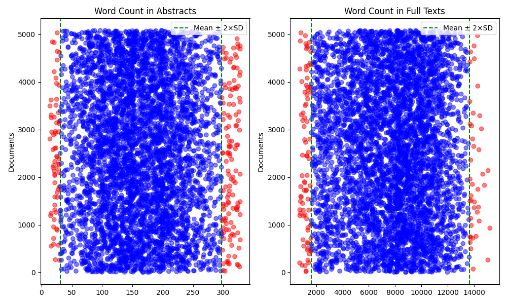
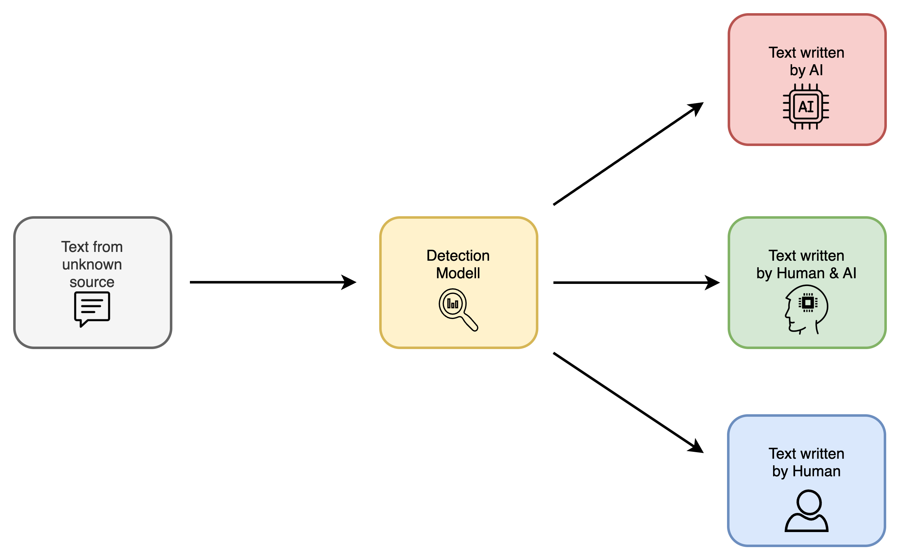
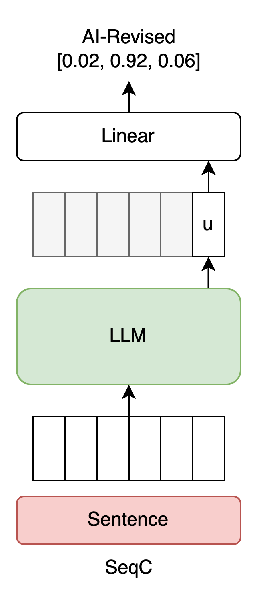

# SciHRA-Detect Dataset

**SciHRA-Detect** (Scientific Human-, Revision-, AI-Texts Detection) is a scientific parallel dataset developed as part of the bachelor thesis *"Differentiating AI Revisions from Human-Generated and AI-Generated Texts in Academic Writing"* by Mithusan Naguleswaran (TU Darmstadt, 2025).

---

## Overview

The dataset contains academic abstracts in three parallel text types:

- **HGT (Human-Generated Text):** Original abstracts from real scientific papers (pre-2020)
- **ART (AI-Revised Text / Hybrid (Mix) Text):** Human-written abstracts stylistically revised by GPT-4o
- **AGT (AI-Generated Text):** Entirely generated abstracts based on full texts using GPT-4o (without seeing the original abstract)

---

## Dataset Creation Pipeline

The SciHRA-Detect dataset was constructed through the following stages:

### 1. **Data Collection**

| **Source** | **Number of Papers** |
|------------|-----------------------|
| NLPeer     | 141                   |
| ArXiv      | 1,659                 |
| PubMed     | 300                   |
| JSTOR      | 900                   |
| **Total**  | **3,000**             |

- Only papers **before 2020** were used to ensure human authorship
- 10 scientific domains were selected for a balanced cross-disciplinary representation

### 2. **Domain Balancing**

To achieve equal representation across disciplines, the final dataset includes 300 papers per domain after balancing:

- Natural Sciences: Nonlinear Sciences (nlin), Condensed Matter (cond-mat), Mathematics (math), Statistics (stat.AP), Astrophysics (astro-ph)
- Applied/Health Sciences: PMC (Medicine & Biology)
- Social Sciences: Area Studies, Social Sciences, Business & Economics
- Computer Science: CS (from ArXiv) and CS.CL (from NLPeer)

<!-- **Category Distribution Before and After Balancing:**

*Figure: Left = raw domain distribution; Right = equalized domain distribution across 10 categories.* -->

---

### 3. Preprocessing & Cleaning

Text cleaning was critical to ensure quality, usability, and fairness. The following steps were applied:

#### Length Filtering
- **Abstract & Full Text Filtering:**  
  Abstracts and full texts were removed if their word count deviated beyond **95% standard deviation**.
- **Full Text Token Limit:**  
  Papers with more than **20,000 tokens** in the full text were excluded (to stay within model input limits).
- **Abstract Token Limit:**  
  Abstracts longer than **455 tokens (~350 words)** were removed (especially from JSTOR).

  

#### Overlap Filtering (Rouge-L)
To prevent the model from “copying” existing abstracts in AGT generation, we filtered papers with high similarity between the abstract and the first paragraph of the full text using **Rouge-L**:

| Dataset  | Rouge-L Threshold |
|----------|-------------------|
| ArXiv    | 70%               |
| PubMed   | 60%               |
| JSTOR    | 75%               |
| NLPeer   | 40%               |

#### Noise Removal
- Papers with **LaTeX commands** (e.g., `\usepackage`) were excluded
- Papers with **over 1,000 math placeholders** (e.g., `@math0`) were removed
- **Multilingual abstracts** were filtered out

---

### 4. **Text Generation**
- **ART (AI-Revised):** GPT-4o revised HGTs for academic style and clarity
- **AGT (AI-Generated):** GPT-4o generated abstracts from full text (without seeing original abstract)
- Prompting used academic abstract guidelines (e.g., University of Wisconsin–Madison)

### 5. **Sentence-Level Conversion**
- Abstracts were split into individual sentences
- Each sentence was labeled with its type: HGT, ART, or AGT
- Final dataset: **~60,000 labeled sentences**

---

## Dataset Format (CSV)

The main dataset file is in comma-separated value (CSV) format, where each row represents a full set of parallel abstracts (human, revised, generated) for one paper, along with metadata.

| **Column**            | **Description**                                                                 |
|------------------------|---------------------------------------------------------------------------------|
| `hgt`                  | Original abstract written by a human (Human-Generated Text)                    |
| `art`                  | Revised version of `hgt` generated by GPT-4o (AI-Revised Text)                 |
| `agt`                  | New abstract generated by GPT-4o based on `full_text` (AI-Generated Text)      |
| `full_text`            | Full body of the paper (excluding the abstract)                                |
| `prompt_art`           | Prompt used for revising the human abstract                                    |
| `prompt_agt`           | Prompt used for generating a new abstract from the full text                   |
| `input_tokens_art`     | Number of input tokens used in the ART revision call                           |
| `output_tokens_art`    | Number of output tokens generated by the model for ART                         |
| `input_tokens_agt`     | Number of input tokens used in the AGT generation call                         |
| `output_tokens_agt`    | Number of output tokens generated by the model for AGT                         |
| `source`               | Source dataset (e.g., ArXiv, PubMed, JSTOR, NLPeer)                            |
| `article_id`           | Internal identifier of the source paper                                        |
| `category`             | Category / Domain assigned |

Each row contains a triplet of texts: human-written, AI-revised, and AI-generated — enabling direct comparison across all forms of authorship.

---

## Usage

This dataset was created for academic research, particularly for evaluating hybrid classification models distinguishing between human, AI-revised, and AI-generated text.

  

---

<!-- ## License

This dataset is licensed under **Creative Commons Attribution 4.0 International (CC BY 4.0)**.

You are free to:
- Use, share, and adapt the dataset
- For commercial and non-commercial purposes
- As long as proper credit is given

Details: [CC BY 4.0 License](https://creativecommons.org/licenses/by/4.0/) -->

## Experiments

The thesis experiments include classification of HGT / ART / AGT sentences.
We fine-tuned two types of models for sentence classification: SciBERT, an encoder-only transformer pre-trained on scientific texts, served as our strong baseline. For large language models, we used quantized LLaMA models to enable efficient training on a single GPU. While SciBERT encodes input for classification, LLaMA and similar decoder-only models were adapted for classification using the Sequence-Based Classification (SeqC) approach, which maps the model’s hidden states to class probabilities. This method has proven effective for leveraging LLMs in classification tasks.

  

## Results

The following table summarizes the main results from our experiments:

**Overall Performance:**

| Model                  | Accuracy | F1-Score | Precision | Recall  |
|------------------------|----------|----------|-----------|---------|
| Baseline SciBERT       | 80.79%   | 81.30%   | 82.57%    | 80.79%  |
| Llama-3.1-8B-Instruct  | 87.19%   | 87.31%   | 87.48%    | 87.19%  |

**Per-Class Metrics:**

| Text Type       | Model    | Precision | Recall | F1-Score |
|-----------------|----------|-----------|--------|----------|
| Human-Generated | Baseline | 93%       | 83%    | 88%      |
|                 | LLM      | 98%       | 93%    | 95%      |
| AI-Revised      | Baseline | 63%       | 79%    | 70%      |
|                 | LLM      | 76%       | 80%    | 78%      |
| AI-Generated    | Baseline | 88%       | 80%    | 84%      |
|                 | LLM      | 88%       | 88%    | 89%      |

*The LLM model outperforms the baseline in all categories, especially for human-generated and AI-revised texts.*

> See [`thesis/Bachelorthesis_Mithusan_Naguleswaran.pdf`](./thesis/Bachelorthesis_Mithusan_Naguleswaran.pdf) for the thesis and in [`assets/model_comparison`](./assets/model_comparison) the full evaluation metrics.

---
### Included Resources:

| Folder        | Content                                                                 |
|---------------|-------------------------------------------------------------------------|
| `models/`     | Configuration files                   |
| `assets/model_comparison/`    | Normalized confusion matrix, Precision-Recall curve, Receiver Operating Characteristic (ROC) curve      |
| `thesis/`     | Official thesis PDF                                                     |

---
### Citation

> Naguleswaran, M. (2025). *Differentiating AI Revisions from Human-Generated and AI-Generated Texts in Academic Writing* [Bachelor thesis, TU Darmstadt]. GitHub. https://github.com/mithuGit/SciHRA-Detect